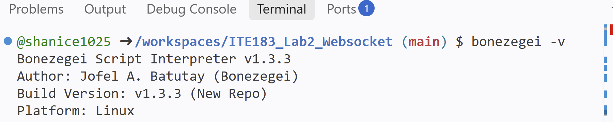
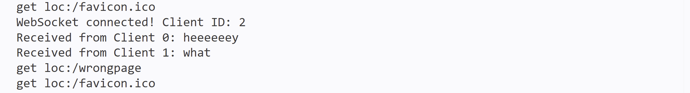
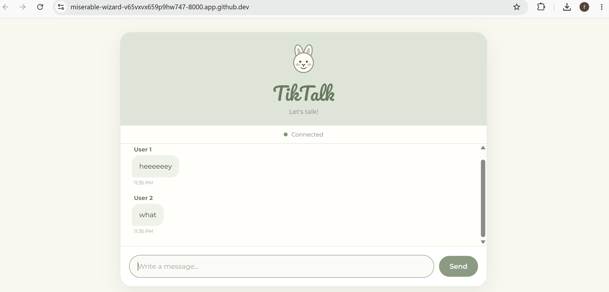
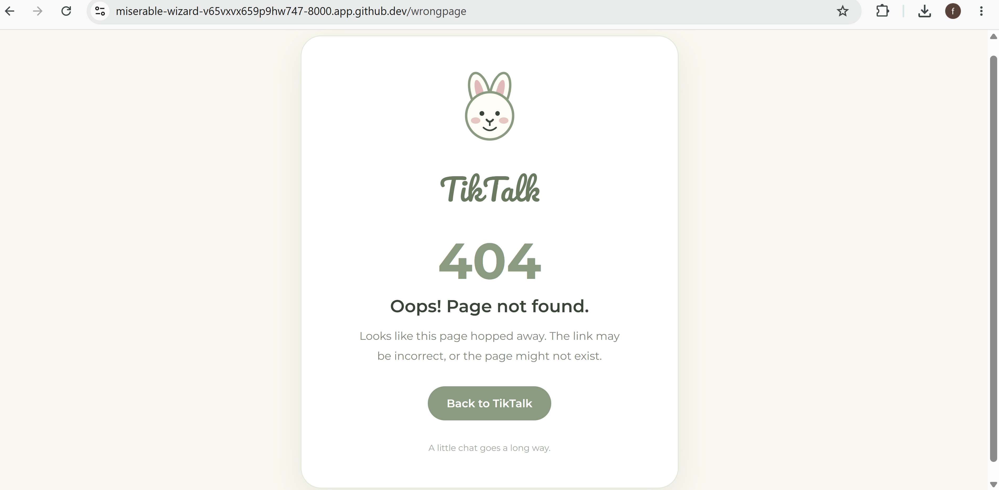

# TikTalk - Simple WebSocket Chat App

**Developed by:** Shanice P. Congson

## Project Overview

TikTalk is a real-time chat application developed using the Bonezegei Scripting Language (BSL), WebSocket, HTML, CSS, and JavaScript. It allows multiple users to connect through a web browser and exchange messages in real time.

This project demonstrates how a WebSocket server handles client connections, receives messages, and broadcasts them to connected users. It also includes a customized chat interface and a custom 404 error page.

## Technologies Used

- **Bonezegei Scripting Language (BSL):** Runs the server application.
- **WebSocket:** Enables real-time communication between connected clients.
- **HTML5:** Provides the structure of the web pages.
- **CSS3:** Styles the chat interface.
- **JavaScript:** Handles WebSocket communication on the client side.
- **GitHub Codespaces:** Provides the development environment.

## Project Structure

```text
ITE183_Lab2_Websocket/
├── .gitattributes
├── .gitignore
├── LICENSE
├── README.md
├── app.bzg
├── package.json
├── lib/
└── public/
    ├── index.html
    └── 404.html
```

## Installation and Execution

### 1. Verify Bonezegei Installation

Run the following command in the terminal to check the installed Bonezegei version:

```bash
bonezegei -v
```

### 2. Install Dependencies

Open the terminal in the project directory and run:

```bash
bzg install
```

### 3. Start the Server

Execute the following command to start the application:

```bash
bzg run
```

The application is configured to use port `8000`. In GitHub Codespaces, open the **Ports** tab and access the forwarded URL for port 8000.

## Features

- Real-time message broadcasting through WebSocket communication.
- Support for multiple connected browser clients.
- Connection status indicator.
- Custom TikTalk interface with a sage-green and cream theme.
- Sender labels such as User 1 and User 2.
- Custom 404 error page for invalid routes.

## Screenshot Documentation

### 1. Bonezegei Version Verification

This screenshot shows the installed Bonezegei version verified through the terminal.



### 2. WebSocket Server Execution

This screenshot shows the TikTalk server running in the terminal, including client connection and message activity.



### 3. Real-Time Chat Communication

This screenshot demonstrates two browser clients exchanging messages through the TikTalk WebSocket server.



### 4. Custom 404 Error Page

This screenshot shows the custom 404 page displayed when a nonexistent route is accessed.




## Conclusion

The TikTalk project demonstrates the implementation of a WebSocket-based chat application using Bonezegei and web technologies. It provides practical experience in server execution, client connections, real-time message broadcasting, and web interface customization.
